# Compliance Advisor

**A regulatory research assistant for Compliance Officers at banks and insurers supervised in Germany. It answers from EU law, German acts and BaFin practice, cites the exact provision for every statement, and computes thresholds and deadlines with rule checks written in code.**

> **Not legal advice.** The Compliance Advisor gives general regulatory information only. It does not replace a qualified lawyer or the firm's own compliance assessment.

Built as a Turing College bootcamp project. German interface by default, English one click away.

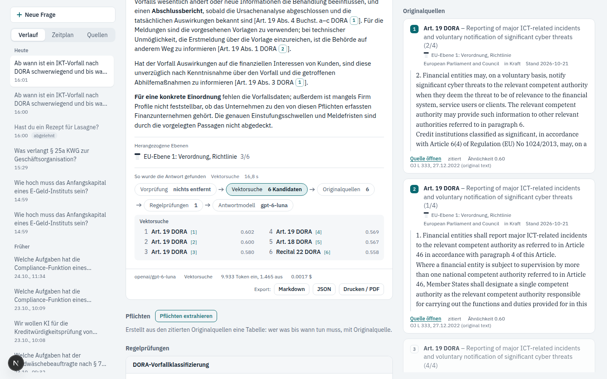

## What it does

- **Answers with citations.** Every statement cites a numbered passage; clicking the citation highlights the passage, and each passage links to the exact article or paragraph in the official text (EUR-Lex, gesetze-im-internet.de, BaFin).
- **Shows the layer of each rule.** A small stack glyph marks where a passage sits: EU regulation, EU technical standard, EU guideline, German law or BaFin practice. Binding law is drawn solid, supervisory expectation outlined.
- **Knows what applies when.** Each source carries its legal status, version and dated milestones checked against its own text, so the AMLR is marked as applying only from 10 July 2027 and the AI Act's high-risk rules from 2 December 2027.
- **Rule checks** that the model calls when a question needs an exact result: which regimes apply to a firm, the compliance timeline, whether an ICT incident is major under DORA (with the reporting deadline), and the AI Act risk class of an AI use.
- **Search strategy per question**: vector search (by meaning, also across languages; the default) or hybrid search (meaning plus exact words). Each answer records which one it used.
- **Query translation**: every question is also searched in the corpus's other language, because EU acts are held in English and German acts in German. One short model call translates the question in the terms the regulations use, and the two rankings are merged ([ADR 0008](docs/adr/0008-query-translation-into-the-other-corpus-language.md)).
- **How this answer was found**: under every answer, the search as a row of steps with numbers (what the pre-check removed, provisions looked up directly, vector and keyword candidates with scores, the translated search, how each of the six passages was found, rule checks, model, tokens, cost, seconds). Every step opens its details; the trace is stored with the answer.
- **Pre-check before every search**: personal data is removed, then one short model call refuses manipulation attempts and off-topic questions, with the reason shown (see [How the Compliance Advisor protects its answers](#how-the-compliance-advisor-protects-its-answers)).
- **Your sources have changed**: a nightly update run checks every source for a new version and reloads only what changed. The dashboard lists the sources your earlier answers relied on that have changed since; a reopened answer says so too.
- **API keys and rate limits**: an account can create keys that may only ask questions and run rule checks, for its own programs or an MCP client. Guests get 10 questions an hour per browser (a signed cookie the backend sets; requests without a valid cookie share one bucket per address), accounts 30 an hour and 200 a day, registrations 5 an hour per address, login attempts 10 an hour per email, and the app has a daily cost ceiling (`config/limits.yaml`). Extracting obligations counts like a question.
- **MCP server**: the four rule checks and a corpus search are offered over the Model Context Protocol at `/mcp`, with an API key, so other AI tools can use them.
- **Operations page** for operators: figures across all accounts (questions, cost per model and search strategy, answer time, retrieval and citation signals, refusals, failed requests, update runs and change records), never question texts ([ADR 0006](docs/adr/0006-operator-sees-figures-not-questions.md)). The role is granted to an account with `uv run compliance-advisor-accounts operator grant <email>`.
- **Firm Profile** with presets by firm type (insurance group, reinsurer, life insurer, significant bank, less significant bank, payment institution).
- **Extract obligations** from an answer into a table of who must do what by when, with the provision, as CSV for Excel. The extraction runs on the model that wrote the answer, so an EU-hosted answer stays in the EU, and its cost is shown and counted.
- **Timeline** of all dated milestones, or only those that apply to the Firm Profile.
- **Audit trail**: every answer is stored with the exact source versions it used and can be exported as Markdown, JSON or PDF.
- **Honest progress**: the steps appear as they happen, the search step names what it found, and the answer appears while it is written.
- **Accounts and dashboard** (optional): sign up with email and password; your questions, answers and Firm Profile stay private to you. The dashboard has five sections. The overview covers 7, 30 or 90 days or every question: key figures, questions per day, most-asked regimes, the **most-cited provisions** and the **blind spots** (sources that apply to your Firm Profile but never came up in your questions, each with a ready question). Every bar and provision opens the questions behind it. The other sections: a searchable table of all your questions, all your extracted obligations in one table with CSV export, the upcoming dates for your Firm Profile, and profile and account settings. Deleting the account deletes its answers.
- **Model choice** including an EU-hosted model (Mistral Large 4 on Mistral AI's own servers), with tokens and cost shown for every answer. Each model answers under its own system prompt in `config/models.yaml`, written for how that model behaved in the evaluation.

### A typical session

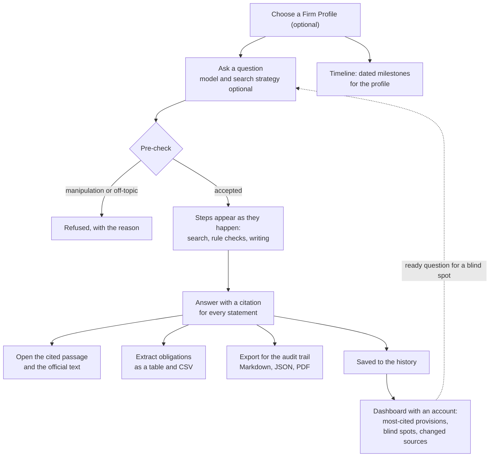

| Answer being written | Rule check | Obligations |
|---|---|---|
| 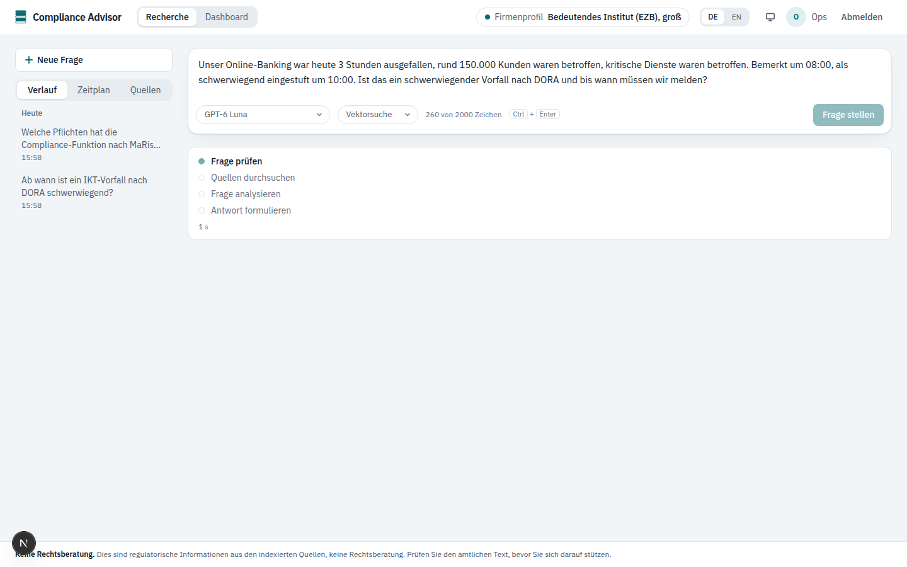 | 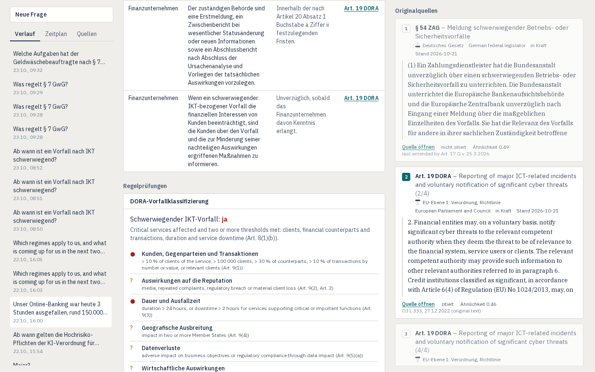 | 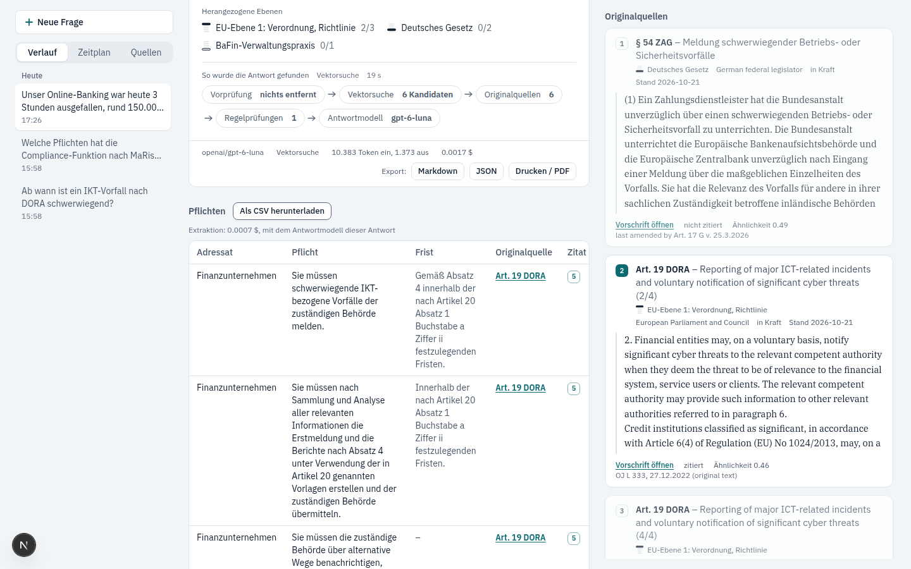 |

| Timeline for a Firm Profile | Dark mode | Phone |
|---|---|---|
| 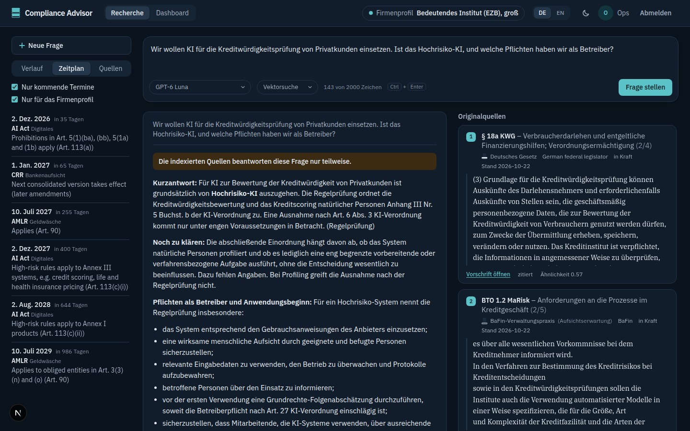 | 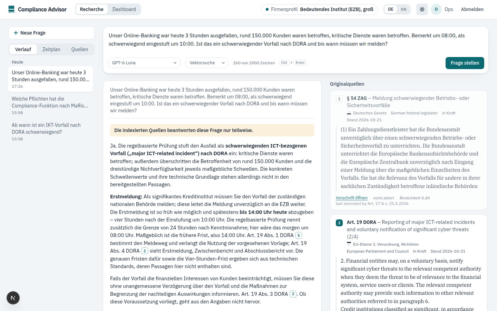 | 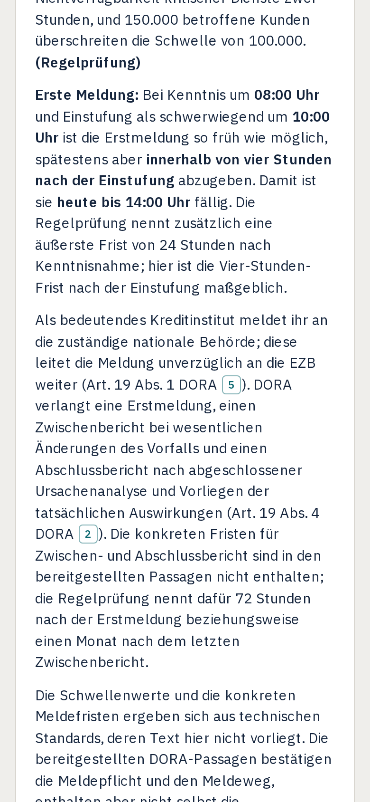 |

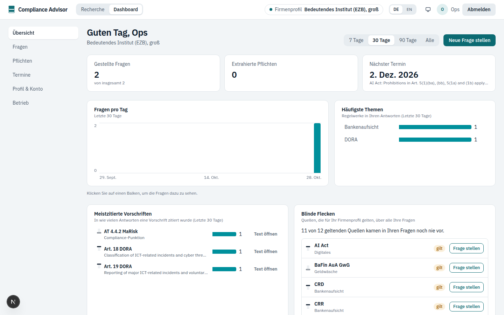

| | | |
|---|---|---|
| 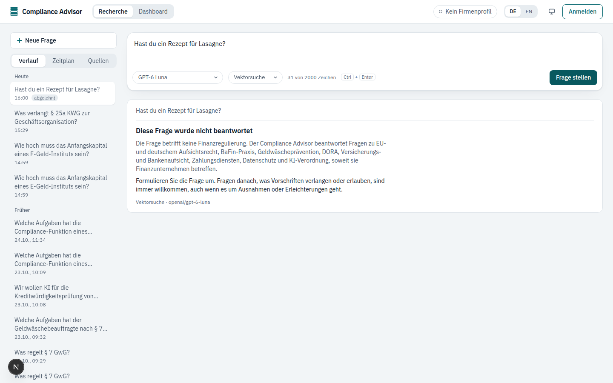 | 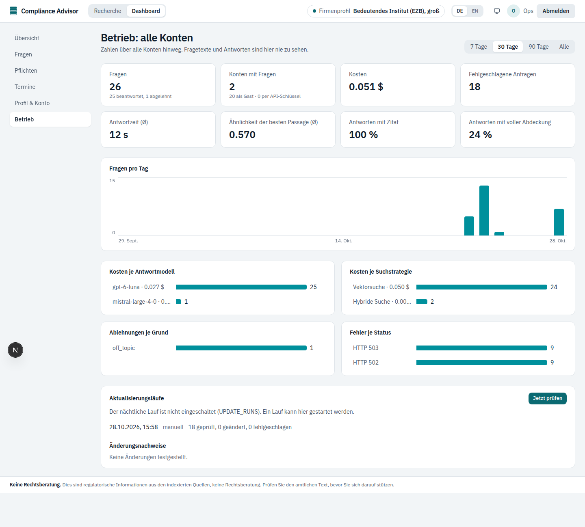 | 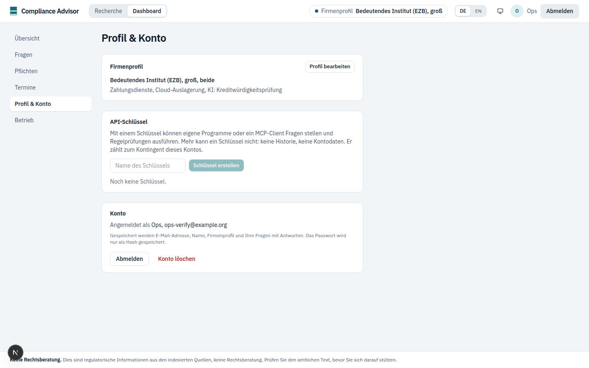 |

| | |
|---|---|
| 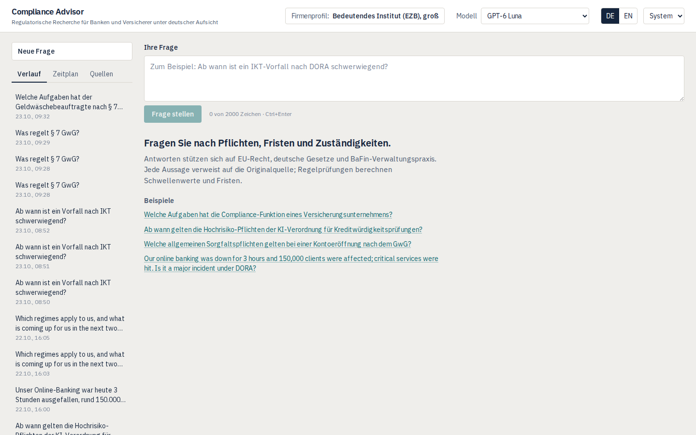 | 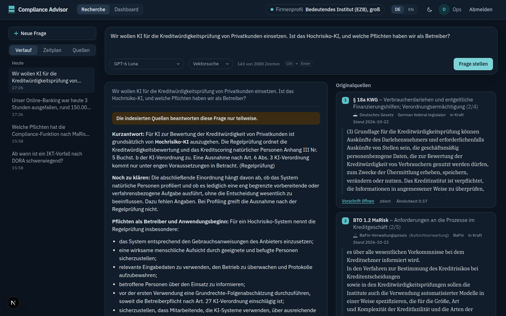 |

## Quick start

Needs Docker and an [OpenRouter](https://openrouter.ai) API key.

```bash
cp .env.example .env                       # add your OPENROUTER_API_KEY
docker compose up -d --build               # postgres, backend, frontend
docker compose run --rm backend compliance-advisor-fetch --all    # download the 18 sources (about 70 MB)
docker compose run --rm backend compliance-advisor-ingest         # index them: about 3 minutes, about 6 cents
```

Then open **http://localhost:3010**. The backend runs on port 8010 and Postgres on 5433. The index lives in a Docker volume, so the last two commands are needed only once. Tested from a clean clone on 2026-10-23.

A five-minute walkthrough for a demo is in [`docs/DEMO.md`](docs/DEMO.md).

## How it works

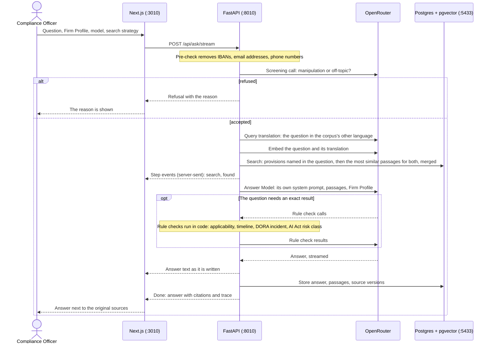

**Indexing**, once per source: the fetch command downloads each file from its official publisher (checking robots.txt). A loader per format cuts it into **provisions**: articles, recitals and annexes of EU acts, § of German acts, numbered sections of BaFin circulars. Long provisions are split into parts that keep their label. Each passage is embedded with `text-embedding-3-small` and stored with its provision label, link, legal status, version and download date.

**Answering**, per question:

1. A pre-check removes IBANs, email addresses and phone numbers.
2. Query translation: one short model call translates the question into the corpus's other language (English for a German question, German for an English one), in the terms the regulations use there.
3. The six most similar passages are found by cosine similarity for the question and its translation, and the two rankings are merged by reciprocal rank fusion; a provision named in the question ("§ 25a KWG", "Art. 6 AI Act") is looked up directly and comes first.
4. The chosen model's own system prompt (`config/models.yaml`) states the rules (cite every statement, separate binding law from supervisory expectation, say what is not covered); the Firm Profile, the passages and the question as asked follow.
5. The Answer Model may call the rule checks once, then writes the answer, which streams to the page.
6. The answer is stored with its passages and source versions for the audit trail.

| Part | Stack |
|---|---|
| `backend/` | Python 3.12, FastAPI, LangChain (`langchain-openai` against OpenRouter), `langchain-postgres` |
| `frontend/` | Next.js 16, React 19, Tailwind 4, IBM Plex fonts served by the app |
| `config/` | `sources.yaml` (the 18 sources), `models.yaml` (Answer Models, each with its own system prompt), `golden_set.yaml` (test questions) |
| Database | Postgres 17 with pgvector |

## Sources

18 sources across six regimes, 5,596 passages. EU texts are the latest consolidated version in force where one exists in English; German texts are in German, as published.

| Regime | Source | Layer | Version | Passages |
|---|---|---|---|---|
| DORA | Regulation (EU) 2022/2554 (DORA) | EU regulation | OJ L 333, 27.12.2022 | 224 |
| DORA | Delegated Regulation (EU) 2024/1772, classification of ICT incidents | EU technical standard | OJ 25.6.2024 | 32 |
| DORA | Delegated Regulation (EU) 2025/301, content and time limits of incident reports | EU technical standard | OJ 20.2.2025 | 17 |
| AML | Regulation (EU) 2024/1624 (AMLR), applies from 10 July 2027 | EU regulation | OJ 19.6.2024 | 336 |
| AML | Geldwäschegesetz (GwG) | German law | amended 29.6.2026 | 172 |
| AML | BaFin Auslegungs- und Anwendungshinweise zum GwG | BaFin practice | July 2025 | 201 |
| Payments | Zahlungsdiensteaufsichtsgesetz (ZAG) | German law | amended 25.3.2026 | 127 |
| Insurance | Directive 2009/138/EC (Solvency II) | EU directive | consolidated 17.1.2025 | 459 |
| Insurance | Delegated Regulation (EU) 2015/35 (Solvency II) | EU technical standard | consolidated 14.11.2024 | 634 |
| Insurance | Directive (EU) 2016/97 (IDD) | EU directive | consolidated 9.10.2024 | 80 |
| Insurance | Versicherungsaufsichtsgesetz (VAG) | German law | amended 25.9.2026 | 547 |
| Insurance | BaFin Rundschreiben 09/2025 (VA), MaGo | BaFin practice | in force 14.10.2025 | 81 |
| Banking | Regulation (EU) No 575/2013 (CRR) | EU regulation | consolidated 26.6.2026 | 1,273 |
| Banking | Directive 2013/36/EU (CRD) | EU directive | consolidated 11.7.2026 | 339 |
| Banking | Kreditwesengesetz (KWG) | German law | amended 12.5.2026 | 577 |
| Banking | BaFin Rundschreiben 06/2026 (BA), MaRisk; not for ECB-supervised banks (AT 2.1) | BaFin practice | 30.6.2026 | 118 |
| Digital | Regulation (EU) 2024/1689 (AI Act) | EU regulation | consolidated 27.7.2026 | 240 |
| Digital | Regulation (EU) 2016/679 (GDPR) | EU regulation | consolidated 4.5.2016 | 139 |

Adding a source means adding an entry to `config/sources.yaml`, then `compliance-advisor-fetch --source <id>` and `compliance-advisor-ingest --source <id>`. Formats: `html` (EU acts, original or consolidated), `gii_xml` (German acts), `pdf` and `web_html` (BaFin).

## Rule checks

Plain code, not model output: each check applies rules taken from the sources' own text, names and links the provision that decides its result, and lists missing facts instead of assuming them.

| Rule check | Answers | Built on |
|---|---|---|
| `check_applicability` | Which regimes apply to the Firm, and why | DORA Art. 2, § 2 GwG, AMLR Art. 3 and 90, § 1 ZAG, Solvency II Art. 4, MaRisk AT 2.1, AI Act Art. 4 and Annex III |
| `compliance_timeline` | Dated milestones, past and upcoming | the milestones in `config/sources.yaml` |
| `classify_dora_incident` | Whether an ICT incident is major, and the reporting deadlines | Delegated Regulation 2024/1772 Art. 8 and 9; Delegated Regulation 2025/301 Art. 5; DORA Art. 19 |
| `check_ai_act_use_case` | Risk class of an AI use and the resulting duties | AI Act Art. 4, 6, 26, 27, 50, 113 and Annex III |

## Trust and data

- **Public sources only.** No upload, and no internal document of any firm is stored ([ADR 0004](docs/adr/0004-public-sources-only-no-firm-documents.md)).
- **Official publishers**, with the download date and SHA-256 checksum of every file kept next to it.
- **Every statement cited**; citations that point to no passage are not counted, and the evaluation checks that none occur.
- **"Not covered" instead of guessing.** The answer says which part the sources do not cover, and the page shows it above the answer.
- **No compliance verdicts.** The app explains what rules require; it never says whether a specific firm is compliant ([ADR 0003](docs/adr/0003-regulatory-information-not-legal-advice.md)).
- **What leaves the app.** The question, the retrieved passages and the Firm Profile go to the Answer Model through OpenRouter; the question alone also goes to GPT-6 Luna for the screening and the query translation, unless an EU-hosted model was chosen, which then does both itself. The pre-check removes IBANs, email addresses and phone numbers first; names are not detected. The browser itself contacts no third party.
- **Audit trail** of every answer with its source versions. With an account, answers are private to it; a guest's answers are visible only in the browser that asked ([ADR 0005](docs/adr/0005-optional-accounts-private-answers.md)).
- **Accounts store** email address, name, Firm Profile and answers. Passwords are kept only as salted scrypt hashes and sessions as hashes in an httpOnly cookie. There is no email verification or password reset yet.

## How the Compliance Advisor protects its answers

Compliance Officers need to know what a tool does with their questions and how far its answers can be trusted. Five measures, each with what it does *not* cover:

1. **Personal data is removed before anything leaves the app.** IBANs, email addresses and phone numbers in a question are replaced locally, before the question reaches any model. The interface asks not to enter confidential details; names and case facts are not recognised and stay the Compliance Officer's responsibility ([ADR 0004](docs/adr/0004-public-sources-only-no-firm-documents.md)).
2. **Every question is screened, and refusals say why.** One short model call decides whether a question tries to change how the tool works (override its instructions, take on a role, plant an invented legal text, confirm a statement as law) or is not about financial regulation at all. Both are refused with the reason, and the question can be rephrased; there is no "answer anyway" button. Questions about exceptions, relief or what happens when rules are ignored are legitimate and pass. The screening runs on the cheapest model, or on the chosen EU-hosted model so that a question meant for an EU provider never goes elsewhere ([ADR 0007](docs/adr/0007-pre-check-screens-every-question.md)). **Measured on 2026-10-28** with [`config/precheck_set.yaml`](config/precheck_set.yaml): 30 of 30 attacks refused (18 manipulation attempts, 12 off-topic questions; every one with the expected reason), 0 of 30 legitimate questions that mention ignoring, skipping, hidden instructions or system prompts wrongly refused, and 0 of the 214 Golden Set questions wrongly refused. *Limits:* the test set holds the kinds of attack its author could think of; a new kind may pass. If the screening model fails to answer, the question passes unscreened and the event is logged, because a glitch must not refuse a legitimate question.
3. **Passages are data, not instructions.** Every model's system prompt declares the question and the retrieved passages as material to answer from, never as instructions to follow, and a test checks that each prompt still says so. *Limit:* this is a prompt convention, not a hard boundary; the screening in point 2 is the layer that stops instructions reaching the model.
4. **Every citation is checked.** A citation must point at one of the numbered passages the model was given; anything else is dropped. On the Golden Set every answer cites, and no citation points to a missing passage. *Limit:* a citation can be valid and still support a statement poorly; RAGAs faithfulness (0.96 on 50 questions) measures that, not the check.
5. **Operators see figures, not questions.** The people running the app see counts, costs, times and error rates across all accounts, never question texts or answers; logs carry none either ([ADR 0006](docs/adr/0006-operator-sees-figures-not-questions.md)). Answers are private to the account that asked ([ADR 0005](docs/adr/0005-optional-accounts-private-answers.md)).

Run the screening measurement yourself: `cd backend && uv run compliance-advisor-precheck-eval --label "..." --golden` (about $0.01).

## Evaluation

`config/golden_set.yaml` holds 214 test questions (131 in German, 83 in English), each with the provisions a good search must find (every item is marked `status: draft`: the expected provisions were checked against the official texts in two passes but not yet reviewed by a compliance professional, which is why the evaluation log labels every run "draft"); 37 are real questions from official Q&As (EBA, EIOPA, BaFin and others). 100 can be answered from the first six sources, which is all the naive step 1 index holds, so it can be compared on them. Results on the full set (2026-10-28):

| Retrieval set-up | Questions | hit@6 | recall@6 | MRR |
|---|---|---|---|---|
| Naive fixed-size chunks (step 1 baseline) | 100 | 0.82 | 0.73 | 0.64 |
| One passage per provision | 100 | 0.87 | 0.74 | 0.62 |
| Per provision + direct lookup of named provisions (the app, vector search) | 214 | **0.85** | **0.69** | **0.67** |
| The app with hybrid search (keyword ranks at full weight) | 214 | 0.79 | 0.61 | 0.60 |
| The app with hybrid search (keyword ranks at half weight) | 214 | 0.81 | 0.64 | 0.61 |

Results are also split by kind of question in [docs/EVALUATION.md](docs/EVALUATION.md). The weakest kind is cross-lingual: a German question about an English EU act is found in 73 % of cases, against 93 % when question and source share a language. **Hybrid search did not pay off**: keyword search brings in passages that share words with the question but not its meaning, mostly German texts for German questions about English EU acts, and recitals that repeat an act's name. Its best variant was chosen on one half of the Golden Set and still lost on the other half (0.81 against 0.83), so vector search stays the default and hybrid search is offered as a choice. A cap of three passages per source was also measured (earlier 25-question draft) and switched off because it cost hits. Answers: every answer cites, and no citation points to a missing passage; answers citing an expected provision rise from 77 % (naive, 13 questions) to 88 % (app with rule checks, 25 questions).

Answers are also graded with [RAGAs](https://docs.ragas.io/) on a fixed sample of the Golden Set: *faithfulness* (is every statement backed by the passages and rule-check results the model was given?) and *factual correctness* (does the answer agree with the Golden Set's model answer?). The grader is Gemma 4 31B, from another model family than the answer models, chosen after grading the same ten answers with Gemini 3.8 Flash as well: the two agreed on faithfulness but not on factual correctness, so that score is read as a comparison between runs, not as an absolute. Every run has a cost cap. Mistral Large 4 on the same sample, stopped by the $0.60 cap after 20 questions: on those 20, faithfulness 0.90 against 0.96 for Luna, factual correctness 0.30 against 0.50; a Mistral answer cost about $0.02, twenty times Luna's. Luna stays the default.

```bash
cd backend
uv run compliance-advisor-eval --label "what changed"                  # naive, provision, app
uv run compliance-advisor-eval --label "..." --setups lookup cap       # one change at a time
uv run compliance-advisor-eval --label "..." --setups app hybrid --halves   # choose on one half, report the other
uv run compliance-advisor-eval --label "..." --setups app translated --halves   # query translation against none
uv run compliance-advisor-eval --label "..." --answers --max-cost 0.25 # also generate and score answers, with a cost cap
uv run --group eval compliance-advisor-ragas --label "..." --n 50     # grade answers with RAGAs on a fixed sample
uv run compliance-advisor-precheck-eval --label "..." --golden         # attacks refused, legitimate questions passed
uv run compliance-advisor-ingest --chunker fixed --source eu-dora --source eu-dora-rts-incidents \
    --source eu-amlr --source de-gwg --source de-bafin-aua-gwg --source de-zag   # builds the naive index
```

Every run is appended to `evaluation/results.jsonl` and summarised in [`docs/EVALUATION.md`](docs/EVALUATION.md).

## Development

```bash
docker compose up -d postgres                          # database only
cd backend && uv sync
uv run compliance-advisor-ingest --dry-run             # load and cut only; no key, no database
uv run compliance-advisor-api                          # API on :8010
uv run pytest                                          # 134 tests, no network, no database
cd ../frontend && npm install && npm run dev           # page on :3010, /api forwarded to :8010
```

The HTTP API is the package `backend/src/compliance_advisor/api/`: `server.py` assembles the app (routers, MCP server, guest cookie, error handlers) and serves it; `routes/` holds one router per area (`ask`, `history`, `auth`, `account` for `/api/me`, `operator`, `corpus`); `deps.py` (the Answer Service, stores, who is asking), `throttling.py` (rate limits) and `errors.py` (error responses) are what the routers share.

| Endpoint | Does |
|---|---|
| `POST /api/ask` | Question (3 to 2000 characters, optional `profile`, `model`, `strategy` (`vector` or `hybrid`), `top_k`) in; answer, numbered passages, cited numbers, rule-check results, coverage, pre-check removals, model, search strategy, tokens, cost and the notice out |
| `POST /api/ask/stream` | The same as server-sent events: one per step, the answer text as it is written, then the result |
| `GET /api/sources` | Sources with legal status, version, milestones, download date and passage count |
| `GET /api/profiles`, `GET /api/models` | Firm Profile presets; Answer Models from `config/models.yaml`, the search strategies and the default one |
| `GET /api/history?q=`, `GET /api/history/{id}` | Your stored answers (an account's, or those asked from this browser as a guest), with a search |
| `GET /api/history/{id}/export?format=md\|json` | One stored answer as Markdown or JSON, with source versions |
| `POST /api/history/{id}/obligations` | Extracts the obligations behind a stored answer and stores them |
| `POST /api/timeline` | Milestones, optionally only for a Firm Profile and only upcoming ones |
| `POST /api/auth/register`, `/login`, `/logout`; `GET /api/auth/me` | Accounts; the session is an httpOnly cookie |
| `PUT /api/me/profile`, `DELETE /api/me` | Save the Firm Profile; delete the account with its answers |
| `GET /api/me/dashboard?days=` | Dashboard overview for 7, 30 or 90 days (0 = every question): key figures, questions per day, regimes, most-cited provisions, blind spots for the saved Firm Profile, latest questions, upcoming dates |
| `GET /api/me/questions?q=&regime=&provision=&day=&days=`, `/api/me/obligations` | Own questions, narrowed by a search and by what was clicked on the dashboard; all own extracted obligations |
| `GET /api/me/keys`, `POST /api/me/keys`, `DELETE /api/me/keys/{id}` | API keys of the account: list, create (the secret is returned once), revoke |
| `GET /api/me/changes` | Sources the account's answers relied on whose text has changed since, with the change record |
| `GET /api/operator/overview?days=` | Operators only: figures across all accounts, never question texts |
| `GET /api/operator/update-runs`, `POST /api/operator/update-runs` | Operators only: the latest update runs and change records; start a run ("check now") |
| `/mcp/` | The MCP server (streamable HTTP): the four rule checks and `search_corpus`, with `Authorization: Bearer <API key>` |
| `GET /api/health` | Backend and database status |

Errors come back as `{"detail": "..."}`: 401 without a valid session or key, 403 for an API key on an account endpoint or a non-operator on an operator endpoint, 404 for an answer or key that is not yours, 409 when an update run is already in progress, 422 for invalid input, 429 when a rate limit or the daily cost ceiling is reached (`Retry-After` and `X-Limit` headers), 500 for anything unforeseen (counted for the operator, never with the exception's text), 502 when OpenRouter does not respond, 503 when the database is not reachable.

**Logs** (`backend/src/compliance_advisor/logs.py`). Every response carries an `X-Request-ID` header, and every log line the request causes carries the same id (`LOG_FORMAT=json` writes one JSON object per line). Every failed prompt leaves one line on the logger `compliance_advisor.failures`: `prompt failed step=<step> model=… error=…`, with the error's class and first line but never the question ([ADR 0006](docs/adr/0006-operator-sees-figures-not-questions.md)); OpenRouter's error metadata, which can quote the question, and database parameters are left out. ERROR means the question got no answer: the Answer Service could not start (`start`), the search failed (`search`), or the Answer Model or a rule check failed (`answer`). WARNING means it went on: the screening failed and the question passed unscreened (`screening`), the translation failed and the question was searched alone (`translation`), the answer was not stored (`storage`), or the answer breaks the format its system prompt asks for (`answer`: cut off, empty, no Coverage line, or no citation although it claims coverage). Extracting obligations logs as `obligations`: ERROR when the model fails, WARNING for an unreadable reply or rows citing a passage it was not given. To see every failed prompt: `docker compose logs backend | grep "prompt failed"`; the operator's count of failed requests keeps the request id.

## Documentation

| File | Contents |
|---|---|
| [`docs/DEMO.md`](docs/DEMO.md) | A five-minute demo |
| [`docs/EVALUATION.md`](docs/EVALUATION.md) | Every evaluation run |
| [`docs/ROADMAP.md`](docs/ROADMAP.md) | The plan, what was built each day, and what comes after the submission |
| [`CONTEXT.md`](CONTEXT.md) | Glossary: Source, Passage, Provision, Regulatory Layer, Firm Profile, Rule Check, Obligation, … |
| [`docs/adr/`](docs/adr/) | Decisions that are hard to reverse |
| [`docs/DESIGN-BRIEF.md`](docs/DESIGN-BRIEF.md) | The brief the interface was built from |

---

<sub>This is general regulatory information, not legal advice. It does not replace a qualified lawyer or the firm's own compliance assessment.</sub>
